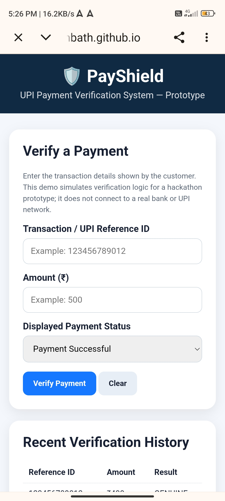

🛡️ PayShield – UPI Payment Verification System

A Smart Payment Verification Prototype for Small Business Vendors

📌 About the Project

PayShield is a web-based prototype designed to help small shop vendors identify suspicious UPI payment screenshots and reduce payment-related confusion.

It aims to distinguish between:

- 🟢 Genuine
- 🟡 Suspicious
- 🔴 Fake

🎯 Problem Statement

Small shop vendors may receive payment screenshots from customers without immediately confirming whether the payment is successful.

PayShield explores a simple interface to help vendors assess payment screenshot authenticity.

✨ Key Features

- QR code simulation.
- Payment screenshot analysis prototype.
- Genuine, Suspicious and Fake classification interface.
- Simple and user-friendly design.
- Local storage support.

🛠️ Technologies Used

- HTML
- CSS
- JavaScript
- Canvas API
- LocalStorage

💡 Project Purpose

To explore how technology can help small business vendors improve their payment verification process.

⚙️ Project Type

Academic Hackathon Prototype.

Note: This is a front-end prototype. It does not independently verify actual UPI bank transactions. Real transaction verification requires secure backend integration with an authorized payment provider.

👩‍💻 Project Team

Team Name: TECH NOVA

- Govarthini M.
- Sivasankari D.
- Venisri S.

🚀 Future Improvements

- Backend integration.
- Secure payment gateway integration.
- Database connectivity.
- Improved screenshot analysis.
- Machine learning-based verification.

📚 Project Domain

FinTech – Financial Technology
## 🌐 Live Demo

[Click here to view PayShield](https://venisambath.github.io/PayShield/)

## 👩‍💻 Developer

Venisri S
Second Year CSDS Student
Interested in Python, Data Science and Web Development.
## 📸 Project Screenshot

